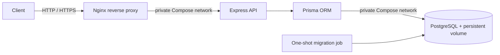
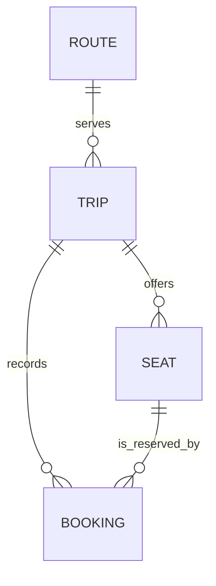

# Architecture

## Data relationships

Each seat number is unique within its trip, and each booking has a unique PNR. A seat can have multiple historical booking rows after cancellations; the seat's current status and the transactional booking workflow prevent more than one confirmed reservation at a time.

Nginx is an optional Compose `proxy` profile because it requires a local TLS certificate. The migration job completes before the API starts. The API is bound to loopback on the host for local checks; its container port and PostgreSQL are only reachable on the Compose bridge network. In production, expose Nginx ports 80/443 and keep PostgreSQL private.

Booking validates the trip and stops, then claims an AVAILABLE seat with one conditional database update in a serializable transaction. Only the transaction that claims the seat can insert a confirmed booking and return its PNR. Competing transactions receive a conflict response. Cancellation conditionally changes the booking state and returns the seat to AVAILABLE in the same transaction.
