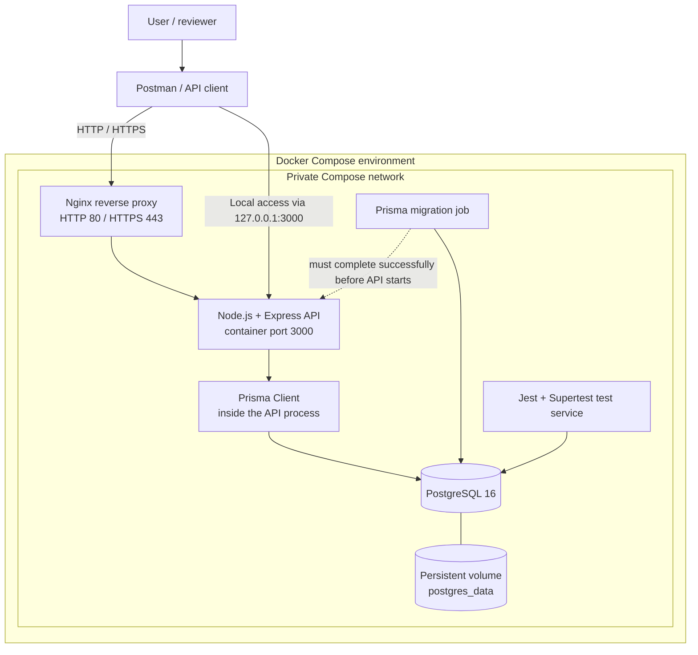
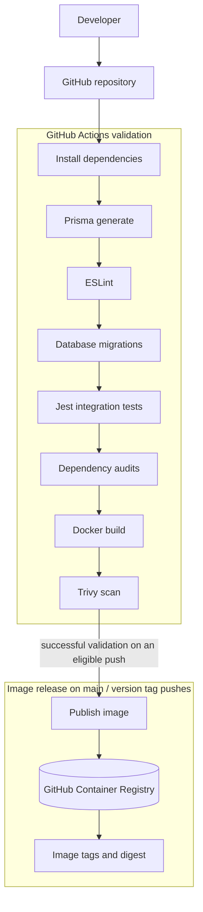
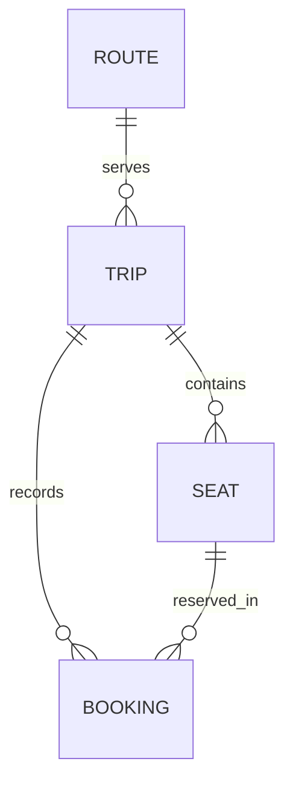
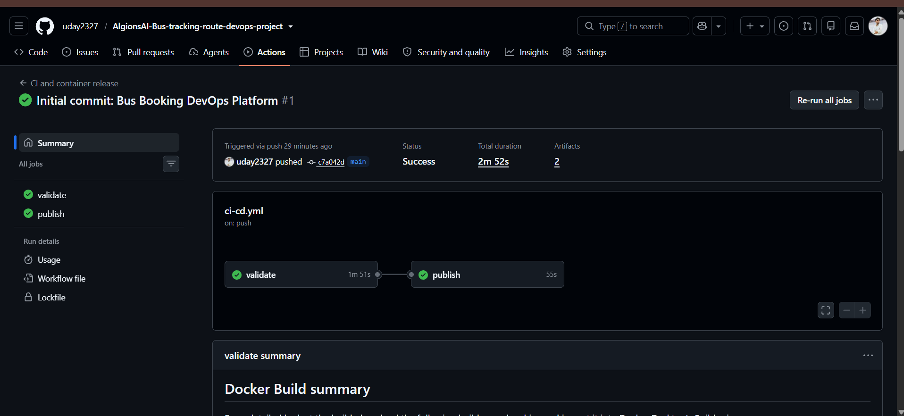

# Bus Trip and Seat Reservation API

A small backend service for trip search, seat availability and reservations. This is the assigned bus service, not a passenger-facing booking website. It demonstrates repeatable containers, CI checks, health reporting, backups and rollback.

## Business problem and scope

Bus operators need a reliable way to publish trips and seats and reserve seats without selling the same seat twice. The service validates reservations against a trip and route, atomically claims the seat, issues a unique PNR, and releases the seat on cancellation. It does not include a frontend, authentication, payments, bus tracking or dashboards.

## Technology

Node.js 22, Express 5, PostgreSQL 16, Prisma 6, Jest, Supertest, Docker Compose, GitHub Actions and Nginx. No Kubernetes, Terraform or paid cloud service is required.

## System Architecture

The Bus Booking Platform uses Node.js, Express, PostgreSQL, Prisma ORM, Docker Compose, Nginx and GitHub Actions. Its main components are the backend API, database, optional reverse proxy, and CI/CD workflow. Docker Compose coordinates the API, database, migration job and isolated test service. PostgreSQL data is stored in a named volume so it survives ordinary container restarts.

### 1. Application Architecture

Requests can reach the API through Nginx or, for local checks, through the loopback-bound API port. Express handles the request and Prisma Client, running inside the API process, communicates with PostgreSQL. The migration job must complete successfully before Compose starts the API; the test service connects to the dedicated test database.



### 2. CI/CD Architecture

GitHub Actions validates pull requests and pushes to `main` or version tags. Validation installs dependencies, generates Prisma Client, runs ESLint, applies migrations to PostgreSQL, runs integration tests, audits dependencies, builds the Docker image and runs Trivy. After successful validation, pushes to `main` and version tags publish the image to GHCR. The full development-dependency audit and Trivy scan are configured as non-blocking checks; see the security notes below for the current audit findings.



### 3. Database Architecture

The database has four primary entities:

- **Route:** source, destination and valid boarding/drop stops.
- **Trip:** bus name, route, travel date and departure time.
- **Seat:** trip seat number and availability status.
- **Booking:** passenger details, unique PNR and booking status.



### 4. Booking Reliability

Booking claims an available seat with a conditional update inside a PostgreSQL transaction. Only the request that claims the seat can create a confirmed booking and receive a PNR; a conflict returns HTTP 409. Cancellation changes the booking status and releases the seat in the same transaction. See [ARCHITECTURE.md](ARCHITECTURE.md) for more data and concurrency details, and [RUNBOOK.md](RUNBOOK.md) for deployment and operational actions.

```text
src/{config,controllers,middleware,routes,services,utils}/  API implementation
prisma/schema.prisma                                      database models
prisma/migrations/                                        checked-in SQL migration
prisma/seed.js                                            repeatable sample data
tests/                                                    PostgreSQL integration tests
nginx/nginx.conf                                          HTTP redirect and TLS proxy
scripts/                                                  backup, restore, local TLS helper
.github/workflows/ci-cd.yml                               validation and image publishing
Dockerfile, docker-compose.yml                            runtime and local services
ARCHITECTURE.md, RUNBOOK.md                                design and operations
```

## Database and booking safety

`Route` has source, destination and valid boarding/drop stops. A `Trip` belongs to a route and has a date and departure time. `Seat` belongs to a trip and is unique by `(tripId, seatNumber)`. `Booking` has a unique PNR, passenger fields and CONFIRMED/CANCELLED status. Foreign keys and indexes are defined in Prisma and the migration.

The booking service claims a seat with a conditional `updateMany` (`status = AVAILABLE`) inside a serializable transaction. Only the transaction that claims the seat inserts a confirmed booking. A conflict returns HTTP 409; no failed reservation is committed. Cancellation conditionally updates the booking and releases the seat in one transaction.

## API

| Method | Path | Purpose |
|---|---|---|
| GET | `/health` | Process liveness |
| GET | `/ready` | Database readiness |
| GET | `/api/routes` | List routes |
| GET | `/api/trips?routeId=1&travelDate=YYYY-MM-DD` | Search trips; filters optional |
| GET | `/api/trips/:id/seats` | List seat availability |
| POST | `/api/bookings` | Reserve a seat |
| GET | `/api/bookings/:pnr` | Retrieve ticket |
| PATCH | `/api/bookings/:pnr/cancel` | Cancel reservation |

Booking JSON example (uses the fixed test fixture; for a live booking, choose a seeded trip/seat from the API and use that trip's date and stops):

```json
{
  "tripId": 1,
  "seatId": 1,
  "passengerName": "Sample Passenger",
  "passengerPhone": "+919876543210",
  "travelDate": "2030-04-05",
  "boardingStop": "Test Board",
  "dropStop": "Test Drop"
}
```

Creation returns HTTP 201 with a 10-character PNR, status and associated trip/seat. Invalid fields/date/stops return 400; missing trip/seat/PNR returns 404; seat conflicts or duplicate cancellation return 409. Errors use `{ "error": "..." }`.

Example successful response (IDs, PNR and timestamp vary):

```json
{
  "id": 1,
  "pnr": "A1B2C3D4E5",
  "tripId": 1,
  "seatId": 1,
  "passengerName": "Sample Passenger",
  "passengerPhone": "+919876543210",
  "boardingStop": "Test Board",
  "dropStop": "Test Drop",
  "status": "CONFIRMED",
  "createdAt": "2026-11-13T22:00:00.000Z",
  "seat": { "id": 1, "tripId": 1, "seatNumber": "T01", "status": "BOOKED" },
  "trip": {
    "id": 1,
    "routeId": 1,
    "busName": "Test Coach",
    "travelDate": "2030-04-05T00:00:00.000Z",
    "departureTime": "09:00",
    "route": { "id": 1, "source": "Test City A", "destination": "Test City B", "boardingStop": "Test Board", "dropStop": "Test Drop" }
  }
}
```

## Local setup (PowerShell)

Prerequisites: Node.js 22, npm and Docker Desktop with Compose. Copy the example config and replace both placeholder passwords:

```powershell
Copy-Item .env.example .env
```

Use a URL-safe app password in `APP_DB_PASSWORD` and `DATABASE_URL`. Compose creates a private bootstrap administrator and a separate application role which owns the app database. Start the all-in-one deployment:

```powershell
docker compose up -d --build
docker compose ps
docker compose logs -f api
Invoke-RestMethod http://localhost:3000/health
Invoke-RestMethod http://localhost:3000/ready
```

Compose waits for PostgreSQL health, applies migrations in a one-shot migration container, then seeds data and starts the API. The API runtime image omits the Prisma CLI and development/test packages. The sample seed creates three routes, six trips over the next two UTC dates and twelve seats per trip. One seat per trip is marked BOOKED to demonstrate both states. Re-running seed is safe for sample rows.

To run the API directly on Windows, point `.env`'s `DATABASE_URL` to a separately running PostgreSQL instance and run:

```powershell
npm.cmd ci
npx.cmd prisma generate
npx.cmd prisma migrate deploy
npm.cmd run db:seed
npm.cmd run dev
```

`docker compose down` removes containers but preserves the named database volume. Do not use `down -v` for ordinary shutdown.

## Ubuntu deployment

These steps use Docker's official APT repository and the Compose plugin. Git and Docker packages can change over time; see the [Docker Engine Ubuntu instructions](https://docs.docker.com/engine/install/ubuntu/) for supported Ubuntu releases and any repository updates. Git is available from Ubuntu's package manager ([Git installation instructions](https://git-scm.com/install/linux.html)).

Install Git and Docker Engine on an Ubuntu release supported by Docker:

```sh
sudo apt update
sudo apt install -y ca-certificates curl git openssl
sudo install -m 0755 -d /etc/apt/keyrings
sudo curl -fsSL https://download.docker.com/linux/ubuntu/gpg -o /etc/apt/keyrings/docker.asc
sudo chmod a+r /etc/apt/keyrings/docker.asc
sudo tee /etc/apt/sources.list.d/docker.sources >/dev/null <<EOF
Types: deb
URIs: https://download.docker.com/linux/ubuntu
Suites: $(. /etc/os-release && echo "${UBUNTU_CODENAME:-$VERSION_CODENAME}")
Components: stable
Architectures: $(dpkg --print-architecture)
Signed-By: /etc/apt/keyrings/docker.asc
EOF
sudo apt update
sudo apt install -y docker-ce docker-ce-cli containerd.io docker-buildx-plugin docker-compose-plugin
sudo systemctl enable --now docker
sudo docker run hello-world
git --version
```

Clone the GitHub repository and configure its local environment. Replace `OWNER/REPO` with the repository created for this submission. Keep the generated passwords URL-safe; hexadecimal values from `openssl rand -hex 24` are suitable for the Prisma connection string.

```sh
git clone https://github.com/OWNER/REPO.git bus-booking-platform
cd bus-booking-platform
cp .env.example .env
nano .env
chmod 600 .env
sudo docker compose up -d --build
sudo docker compose ps
curl --fail http://localhost:3000/health
curl --fail http://localhost:3000/ready
```

Set new values for `POSTGRES_ADMIN_PASSWORD` and `APP_DB_PASSWORD` in `.env` before the first start. If Docker warns that the current user cannot access its socket, continue using `sudo docker`; membership in the `docker` group grants root-equivalent control.

For local HTTPS on Ubuntu, create an untrusted self-signed certificate and start the optional Nginx proxy:

```sh
mkdir -p nginx/ssl
openssl req -x509 -nodes -days 365 -newkey rsa:2048 \
  -keyout nginx/ssl/server.key -out nginx/ssl/server.crt \
  -subj "/CN=localhost" -addext "subjectAltName=DNS:localhost,IP:127.0.0.1"
chmod 600 nginx/ssl/server.key
sudo docker compose --profile proxy up -d nginx
curl -k --fail https://localhost/health
```

Browsers warn because this local certificate is not trusted. For a real domain, point DNS at the Ubuntu host, obtain a certificate from a trusted CA, place its full-chain certificate and private key at `nginx/ssl/server.crt` and `nginx/ssl/server.key`, then run `sudo docker compose --profile proxy up -d nginx`. Update `server_name` in `nginx/nginx.conf` to the domain. Protect the private key, exclude it from Git, and refresh the mounted certificate files and restart Nginx after each renewal. Permit inbound TCP 80 and 443 at the host/network firewall; PostgreSQL remains on Compose's private network and the API port binds to loopback.

To restart after a host reboot or application change, use `sudo systemctl status docker` and `sudo docker compose up -d`; the `unless-stopped` policy also restarts the API and database containers. Verify `sudo docker compose ps`, the two health URLs above, and `sudo docker compose logs --tail=100 api db`.

## Environment variables

| Variable | Purpose |
|---|---|
| `POSTGRES_DB`, `POSTGRES_ADMIN_USER`, `POSTGRES_ADMIN_PASSWORD` | Private PostgreSQL initialization account |
| `APP_DB_USER`, `APP_DB_PASSWORD` | Application database owner |
| `DATABASE_URL` | Prisma connection string (`db` hostname inside Compose) |
| `TEST_DATABASE_URL` | Dedicated Jest database; its name must end with `_test` |
| `PORT`, `API_PORT` | API listen and loopback host port |

Never commit `.env`, TLS private keys or database dumps. `.env.example` contains placeholders only.

## Migrations and tests

Integration tests clear and rebuild their fixture before each case. Do not point them at the sample-data database. The Compose bootstrap creates a separate `bus_booking_test` database. Build the test image after changing application/test files or dependencies, then run the already-built image without forcing another build:

```powershell
docker compose --profile test build test
docker compose --profile test run --pull never --rm test
```

The test container migrates that test database and runs Jest/Supertest inside an isolated container on the Compose network. The run command reuses `bus-booking-api:test`; it does not build or pull an image. For a directly installed PostgreSQL, create a dedicated database ending in `_test`, set `TEST_DATABASE_URL`, migrate it, then run `npm.cmd test`. Tests cover health/readiness, route/trip/seat queries, validation, booking, PNR lookup, cancellation and concurrent requests against one seat.

## CI and image releases

`.github/workflows/ci-cd.yml` runs on pull requests, pushes to `main`, and version tags. It installs locked dependencies, runs ESLint and PostgreSQL-backed Jest tests, audits dependencies, builds a commit-tagged Docker image and reports Trivy findings for high and critical image vulnerabilities. The image scan is informational; the production `npm audit` gate blocks on high-severity production dependency advisories. After validation, main/tag pushes publish SHA and release tags to GHCR using `GITHUB_TOKEN`. CI does not deploy. GitHub repository policy must allow Actions to write packages. A publish is confirmed only by a successful workflow and visible GHCR package.

For submission evidence, capture the green Actions run (including test summary), copy the published image's full commit tag and digest from the GHCR package page or `docker buildx imagetools inspect ghcr.io/OWNER/REPO:sha-COMMIT`, and include those with the repository URL. A local build is not evidence of a GHCR publish.

### Successful GitHub Actions run

The initial CI and container release completed successfully, including validation and image publishing:



## Docker, Nginx and HTTPS

The API image uses a Node 22 slim base, a non-root user and a health check. Compose exposes the API on host loopback for local tests and keeps PostgreSQL on the internal network. The optional Nginx `proxy` profile exposes ports 80/443.

| Service | Port | Host reachability |
|---|---:|---|
| API | 3000/TCP | Loopback only (`127.0.0.1`) |
| PostgreSQL | 5432/TCP | Compose network only; not published to the host |
| Nginx HTTP | 80/TCP | Host interfaces when the `proxy` profile is enabled |
| Nginx HTTPS | 443/TCP | Host interfaces when the `proxy` profile is enabled |

To create a local self-signed certificate on Windows:

```powershell
./scripts/generate-local-cert.ps1
docker compose --profile proxy up -d nginx
```

Open `https://localhost`; the browser warns because the certificate is untrusted. For a public domain, use a certificate from a trusted CA, configure the real hostname and protect its private key outside Git. Expose only 80/443 at the host firewall.

## Health, logs and recovery

```powershell
docker compose ps
docker compose logs -f api
docker compose logs -f db
docker compose restart api
```

`/health` indicates the process responds. `/ready` queries PostgreSQL and returns 503 if unavailable. JSON logs include timestamp, method, path, status and duration; errors and startup/shutdown messages are JSON. Compose health checks and `unless-stopped` policies support detection and restart. See [RUNBOOK.md](RUNBOOK.md) for failure exercises.

## Backup and restore

Scripts use the app role already present in the Compose database container. Windows PowerShell can use the Node wrappers (no WSL needed):

```powershell
npm.cmd run backup
npm.cmd run restore -- backups/bus_booking_YYYYMMDDTHHMMSSZ.dump
```

The shell scripts are also available in WSL/Git Bash:

```sh
sh scripts/backup.sh
sh scripts/restore.sh backups/bus_booking_YYYYMMDDTHHMMSSZ.dump
```

Restore replaces database objects/data. Create a separate backup first. The script prints the restored route count; also verify `/ready` and `GET /api/routes`. Keep backup files in protected storage outside the repository.

## Rollback

Keep immutable GHCR tags from successful commits. Set `API_IMAGE` in `.env` to the previous known-good `ghcr.io/OWNER/REPO:sha-...` tag, then run `docker compose pull api` followed by `docker compose up -d --no-build api`. Verify health and logs. The persistent database volume remains. Roll back schema changes separately with a compatible migration or planned restore.

## Demo and evidence plan

In a 3–5 minute demo: (1) show the architecture and passing CI run, (2) call `/health`, `/ready`, routes/trips/seats, (3) reserve a seat twice and show one 201 plus one 409, then cancel and show it available, (4) stop PostgreSQL and show `/ready` fail before restart/recovery, and (5) show backup/restore output and the previous image tag rollback command. Capture the test output, container health/logs, backup/restore route count, and GHCR tag/digest. Record only after a successful push and pipeline run.

## Security and limitations

API and database container ports are not publicly bound; PostgreSQL is only on the Compose network. The API image omits development and optional dependencies. The 2026-11-14 production dependency audit (`npm audit --omit=dev --omit=optional`) found zero vulnerabilities. A compatible, non-forced audit update moved ESLint to 10.15.0 and its `minimatch` dependencies to 11.0.8, clearing the three moderate findings. The remaining full development audit reports 3 high and 6 low package findings. The high findings share the Prisma CLI 6.19.3 → `@prisma/config` → vulnerable `deepmerge-ts` chain; npm's available fix requires the breaking Prisma 7.10.1 upgrade. Jest 29.7.0's dependency tree also includes vulnerable `deepmerge` 4.3.1; npm only offers a breaking Jest downgrade to 25.1.0, so that change was not applied. CI runs the full audit on a best-effort basis while the production audit remains a gate. These findings are in development tooling, which is excluded from the production image. Local TLS is self-signed, and example passwords must be changed before deployment. No authentication, payment integration, seat pricing, partial-route allocations, production secret manager, remote cloud host or public trusted certificate is included. Seeded dates are relative to the day the seed runs.
